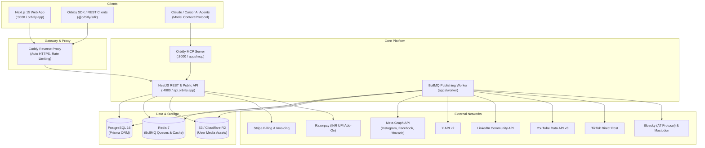

# 🪐 Orbitly — Global Social Media Scheduling & Publishing Platform

> **Plan once. Publish everywhere.**

Orbitly is an original, production-grade social media command center designed for freelancers, creators, marketing teams, and agencies worldwide to plan, create, schedule, and publish content across every major social network from a unified dashboard.

---

## 🏗️ System Architecture



---

## ⚡ Run Locally in 5 Commands

```bash
# 1. Clone the repository and navigate into the workspace
git clone <your-repo-url> orbitly && cd orbitly

# 2. Copy the environment variables template
cp .env.example .env

# 3. Start local infrastructure (PostgreSQL 16, Redis 7, MinIO, Mailpit)
docker compose up -d

# 4. Install all dependencies, generate Prisma models and seed sample data
pnpm install && pnpm db:generate && pnpm db:push && pnpm db:seed

# 5. Launch all services concurrently (Web on :3000, API on :4000, Worker daemon)
pnpm dev
```

### Local Services & Port Mappings
* 🌐 **Orbitly Web App**: [http://localhost:3000](http://localhost:3000)
* 📚 **API Swagger Documentation**: [http://localhost:4000/docs](http://localhost:4000/docs)
* 📖 **Public API Interactive Docs**: [http://localhost:3000/en/docs/api](http://localhost:3000/en/docs/api)
* ✉️ **Mailpit Email Testing Web UI**: [http://localhost:8025](http://localhost:8025)
* 🗄️ **MinIO S3 Console**: [http://localhost:9001](http://localhost:9001) (`minioadmin` / `minioadmin`)

### Default Seed Credentials
* **Email**: `demo@orbitly.app`
* **Password**: `Password123!`
* **Workspace**: `Sarah Creatives` (Role: `OWNER`)
* **Admin Login**: `ops@orbitly.app` (Platform Role: `SUPERADMIN`)

---

## 📦 Monorepo Workspace Structure

```
orbitly/
├── apps/
│   ├── web/         # Next.js 15 App Router, Tailwind, next-intl (7 locales, RTL), shadcn/ui
│   ├── api/         # Modular NestJS REST API, Swagger, Public REST API v1, Auth, Webhooks
│   ├── worker/      # BullMQ delayed scheduler daemon for cross-network publishing & dunning
│   └── mcp/         # Official Model Context Protocol (MCP) server for autonomous AI agents
├── packages/
│   ├── db/          # PostgreSQL schema (Prisma 6), migrations, multi-tenant query guard
│   ├── shared/      # Single source of truth plan limits, Zod schemas, AES encryption, DTOs
│   ├── sdk/         # Official TypeScript/JavaScript Client SDK (@orbitly/sdk)
│   └── config/      # Shared ESLint, Prettier, Tailwind presets, and TypeScript configs
├── docs/            # Architecture, deployment, runbooks, platform review guides, and ADRs
└── monitoring/      # Alerting rules and production Grafana dashboard JSON
```

---

## 🛡️ Production Verification & Quality Gates

Run the verification pipeline locally:
```bash
# 1. Typecheck all workspaces (zero errors)
pnpm -r typecheck

# 2. Run unit and integration tests (114 passing tests)
pnpm test

# 3. Run E2E test suite with Playwright
pnpm --filter @orbitly/web test:e2e

# 4. Spin up single-server production stack with Caddy
docker compose -f docker-compose.prod.yml up -d
```

---

## 📚 Documentation Index
- [Architecture Guide](docs/architecture.md)
- [Single Source of Truth Plan Limits](packages/shared/src/constants/plans.ts)
- [Deployment Guide (VPS vs Cloud)](docs/deployment.md)
- [Security Review & OWASP Top 10](docs/security-review.md)
- [Incident Runbooks](docs/runbooks/)
- [Contributing Guidelines](CONTRIBUTING.md)
- [Code of Conduct](CODE_OF_CONDUCT.md)
- [Pre-Launch Checklist](docs/launch-checklist.md)
